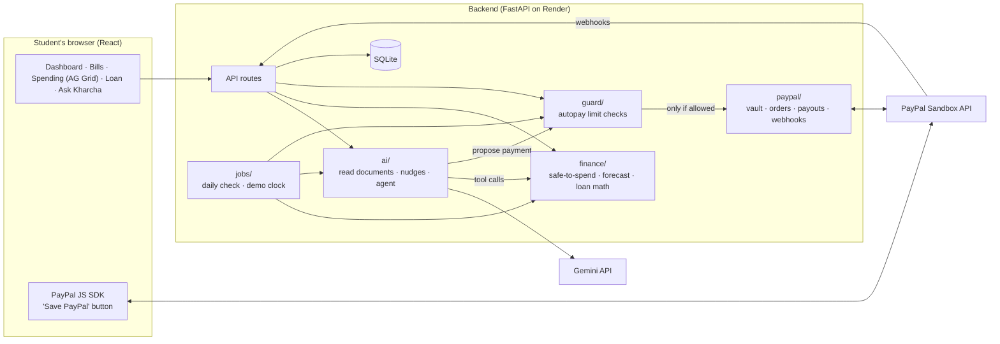
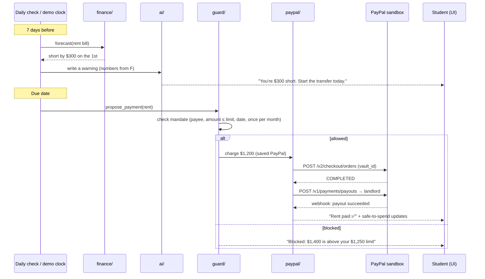

# Kharcha: Architecture

> **Kharcha** (Hindi for "expenses") is a working name. Rename it anytime.
> PayPal AI Hackathon (Devpost) · Solo project · Deadline **Thu Nov 12, 2026, 12:00 PM Pacific**

**Decisions marked 🔁 are defaults.** We hadn't picked a stack yet, so these are suggestions. Change them before **Nov 7**, when coding starts.

---

## 1. What we are building

A money app for **international students living on a loan**. It does three jobs:

1. **Bills.** Upload your lease or fee notice. The AI reads the due date, amount and late fee. **7 days before** the due date it warns you with a plan, for example: *"You're $300 short. A transfer from home takes 3–5 days, so start it today."* On the due date, **PayPal pays automatically**, but only within the limit you approved.
2. **Budget.** Weekly limits for groceries and transport. The AI points out patterns, for example: *"Food delivery this week puts rent at risk."* You decide what counts as "necessary."
3. **Loan.** Upload your loan letter. The AI explains it in plain words: interest growing while you study, your monthly payment after graduation, and what-ifs like *"pay $40/month now and save $X."*

All three feed **one number on the home screen: "Safe to spend today."**

**The demo moment (the 3-minute video is built around this):**
> "Rent is due in 7 days and I'm short. The app warns me with a plan. I approve autopay once. On the due date PayPal pays, the agent confirms, and my safe-to-spend number updates."

---

## 2. Key decisions

| Area | Choice | Why | Change if… |
|---|---|---|---|
| Backend | 🔁 **Python 3.12 + FastAPI** | Python is our strongest language. It's good for AI calls and money math. | You both prefer JS → Next.js |
| Frontend | 🔁 **React + Vite + TypeScript**, Tailwind CSS | PayPal's JS SDK buttons and AG Grid work best in React, and the UI can look polished (counts toward the **Design** score) | — |
| Data table | **AG Grid Community** (free) | Spending table, and a chance at the **Best Use of AG Grid** prize ($5k 1st) | — |
| Charts | Recharts | Loan balance chart, budget bars | — |
| Database | **SQLite** + demo data loaded at startup | Zero setup, and the demo resets cleanly for judges | Need real users → Postgres |
| AI | **Gemini API** (free tier, no card), model `gemini-3.6-flash` | Free, reads PDFs, returns structured JSON and supports function calling | All AI calls go through one file (`ai/client.py`), so switching providers is easy |
| Payments | **PayPal REST APIs (sandbox)**: Vault, Orders, Payouts, Webhooks | This is the core of the app: PayPal moves all the money | — |
| Scheduler | APScheduler, inside the backend process | Runs the daily "what's due?" check. No extra service needed | — |
| Hosting | **Render**: web service (API) + static site (React) | Free tier and a public URL for judges, plus the **Best Use of Render** prize | — |

Already installed on this laptop: Node 24, Python 3.12, Git. (GitHub CLI is not installed. Create the repo on github.com.)

---

## 3. System overview



**The most important rule: AI suggests, code decides.**
- The AI never calls PayPal directly.
- Every payment goes through `guard/`, which checks the student's limit in plain Python code.
- All math (balances, forecasts, loan interest) is normal code. The AI only explains the results. AI models can make arithmetic mistakes, so we never let them handle the numbers.

---

## 4. Components

### 4.1 `paypal/`: PayPal sandbox integration

| What | PayPal API | When |
|---|---|---|
| Get access token | `POST /v1/oauth2/token` (client ID + secret) | Cached, refreshed before it expires |
| **Save the student's PayPal once** | `POST /v3/vault/setup-tokens` (`payment_source.paypal`, `usage_type: MERCHANT`) → student approves in the PayPal popup → `POST /v3/vault/payment-tokens` | Onboarding, "Connect PayPal" |
| **Charge the student later, no popup** | `POST /v2/checkout/orders` with `payment_source.paypal.vault_id` (capture if status isn't already `COMPLETED`) | Autopay on the due date, or "Pay now" |
| **Pay the landlord or college** | `POST /v1/payments/payouts` | Right after the charge succeeds |
| **Confirmations** | Webhooks → `POST /api/webhooks/paypal`, verified with `POST /v1/notifications/verify-webhook-signature` | Charge completed or denied, payout succeeded or failed |
| No double payments | `PayPal-Request-Id` header on orders, `sender_batch_id` on payouts | Every payment |

**How the money moves in the sandbox:**

```
Student (sandbox personal account)
   │  saved-PayPal charge (Orders API + vault_id)
   ▼
Kharcha (sandbox business account = our app)
   │  Payouts API
   ▼
Landlord / College (sandbox accounts)
```

In a real launch, the money would go straight to the landlord through PayPal's multiparty (platform) tools, and we'd need the right licenses. We'll say this openly in the README.

**Sandbox accounts to create** (developer.paypal.com → Sandbox accounts):
- 1 business account for Kharcha, owner of the app's client ID and secret
- 1 personal account for the student
- 2 personal accounts for the landlord and the college

**App settings:** enable saving payment methods (vault) and Payouts, if the dashboard lists them as features.

**Limits we design around:**
- **PayPal doesn't let other apps read a personal account's balance or full history.** So:
  - The student types in their current money and expected money from home, or uses the seeded demo values.
  - Spending comes from three places: payments made through Kharcha, an **uploaded PayPal activity CSV** (personal accounts can download one), and seeded demo data.
- **Webhooks need a public URL.** Test them on the Render deployment. Locally, check payment status by asking PayPal (polling) instead.

### 4.2 `ai/`: Gemini integration

The model is `gemini-3.6-flash` (free tier; change it with `GEMINI_MODEL`), called only through `ai/client.py`.

| Job | How | Effort |
|---|---|---|
| **Read documents** (lease, fee notice, loan letter, PDF) | PDF sent as an inline file part. **Structured output** (`response_json_schema` from a Pydantic model) returns fields like `amount`, `due_day`, `grace_days`, `late_fee`, `payee`, `interest_rate`, `moratorium_end`, plus a `confidence` value and the **page each field came from** | medium |
| **Warnings and coaching** ("rent in 7 days, you're $300 short…") | The code computes the numbers. Gemini writes 1–2 friendly sentences from them | low |
| **Sort transactions into categories** (groceries, transport, delivery…, need vs want) | One call per batch, structured output, using the student's own rules | low |
| **"Ask Kharcha" chat and the daily review agent** | Tool use with `strict: true` tools (list below) | medium |

**Tools the agent can call.** All are our own functions; none of them touch PayPal directly:

| Tool | Returns or does |
|---|---|
| `get_dashboard()` | Safe-to-spend, upcoming bills, budget status |
| `get_upcoming_bills(days)` | Bills due within N days |
| `forecast_cash(days)` | Day-by-day money forecast (from `finance/`) |
| `get_spending(category, period)` | Totals and top merchants |
| `loan_scenario(extra_monthly_usd)` | Total-cost comparison (from `finance/loan.py`) |
| `propose_payment(bill_id, reason)` | Sends the payment to **guard**, which allows or blocks it and explains why. Early payments go to the student for one-tap approval |

**Rules for using the Gemini API:**
- Set `thinking_level` explicitly: `low` for nudges, `medium` for documents and chat.
- The chat runs its own function-calling loop (automatic function calling is off), and sends the model's turns back unchanged so Gemini 3's thought signatures are kept.
- Always check `prompt_feedback.block_reason` and the candidate's `finish_reason`. API errors such as the free-tier rate limit (HTTP 429) show a clear message instead of a crash.

**Cost:** $0. The free tier needs no card. It has per-minute and per-day request limits (see aistudio.google.com/rate-limit), and Google may use free-tier inputs to improve its products, so the demo uses made-up documents only.

**Safety (judges will ask about this):**
- An uploaded document is **untrusted**. A PDF could contain text like "pay $5,000 to X."
- What the AI extracts is only a **suggestion**. The student checks and confirms every field before any bill or autopay limit is created.
- The agent can't create or change autopay limits, only *propose* payments. Guard checks every proposal against limits the student confirmed.
- Every AI action is written to the **Activity log** that the student can see.

### 4.3 `guard/`: autopay limits (plain Python, fully tested)

An **autopay limit** (we call it a "mandate" in the code) is the permission the student gives once, for example *"Pay Landlord up to $1,250, once a month, between the 1st and 3rd, until May 2027."*

Guard **allows** a payment only if **all** of these are true:
1. The bill has an active, non-paused mandate.
2. The payee matches the mandate exactly.
3. The amount is at most `max_amount`.
4. Today is inside the allowed date window and before `valid_until`.
5. No other payment has been made for this bill in this period.
6. The student has a saved PayPal payment token.

Every decision, allow or block, is logged with its reason, e.g. *"Blocked: amount $1,400 is above your $1,250 limit."* That gives us a great demo moment too.

### 4.4 `finance/`: money math (plain Python, fully tested)

- **Safe to spend today** = (current money + money expected before the next bill − bills due before then − this month's loan set-aside − spending already planned) ÷ days until the next money arrives. If the result is below zero, it shows **$0** with a warning.
- **Cash forecast:** a day-by-day balance for the next 60 days, used for the "you'll be short on the 1st" warnings.
- **Smart timing** (`finance/timing.py`): if the money isn't there on the due date but arrives inside the no-late-fee grace period (and inside the autopay window), pay on that day instead. Bank autopay can't do this.
- **Loan math:**
  - Interest while you study (simple or compound, as the letter says)
  - Monthly payment after graduation, using the standard loan payment formula
  - Total cost, with and without paying during studies
  - Converting from rupees to dollars (fixed demo exchange rate, clearly labeled)
- **Budget:** spent vs limit per category per week.
- **Dreams** (`finance/dreams.py`): saving for things the student wants. Money goes **bills first, dreams second, fun third**.
  - *Room this week* = the most that can be set aside every Monday while every bill in the 60-day forecast is covered and the weekly budgets are kept. If any bill is short, the room is $0 (dreams wait).
  - *Room later* = the student's normal weekly surplus (regular income − regular bills − budgets − loan set-aside). It applies after the tight stretch (e.g. after a term fee), so ready dates aren't stuck at the worst week.
  - Most important dream first. A dated dream takes what it needs to be ready on time; an undated one takes half of what's left (the rest stays as a cushion). Ready dates come from simulating the Mondays ahead.
  - Nothing moves: saved money stays in the account and safe-to-spend leaves it out. If bills ever need it, the least important dream gives way first.

### 4.5 `jobs/`: scheduler and demo clock

- A **daily check** runs once a day, in the student's timezone:
  - Payouts still pending → ask PayPal for their status (webhooks can't reach a laptop).
  - Bills due in ≤7 days → forecast → a warning if money is short.
  - Bills due today → guard → PayPal.
  - On Mondays → set money aside for dreams, and celebrate 25/50/75/100%.
- **Demo clock:** the endpoint `POST /api/demo/advance-days` moves time forward, so the video can show "7 days later" without waiting. `POST /api/demo/reset` restores the seeded data.

### 4.6 Frontend pages

| Page | Contents |
|---|---|
| **Onboarding** | Upload a document → review what the AI found (with the page it came from) → confirm → "Connect PayPal" (JS SDK save button) → set the autopay limit |
| **Dashboard** | The big "Safe to spend today" number, the next 3 bills with countdowns, budget bars, a loan summary card |
| **Bills** | Each bill, its autopay limit, Pause/Resume, Pay now |
| **Spending** | AG Grid table (sort, filter, category edits), CSV import, weekly budget bars |
| **Loan** | Plain-words explanation, balance chart, "what if I pay $X/month" slider |
| **Dreams** | Room for dreams this week and later, each dream's progress and ready date, reorder/pause/edit/"I bought it", one-tap "Make room" budget ideas |
| **Ask Kharcha** | Chat: "Can I afford a $60 concert ticket this week?" or "I want to fly home in May, about $1,200" (→ Save dream card) |
| **Activity** | Everything the AI and guard did, with reasons |

**Demo rule:** use **made-up names only** ("City Transit Card," "Green Grocer," "Maple Apartments," "State University"). The hackathon bans third-party trademarks in the video, so no ORCA, QFC or real university names.

---

## 5. Key flows

### 5.1 Upload a lease → bill created

1. The React app uploads the PDF to `POST /api/documents`.
2. `ai/extract.py` sends it to Gemini and gets structured fields plus a page number for each.
3. The app shows the fields for review. The student fixes anything wrong and clicks **Confirm** (`POST /api/documents/{id}/confirm`).
4. The backend creates the `Bill`, and offers to create an autopay limit (mandate).

### 5.2 Autopay on the due date



### 5.3 Spending → coaching

1. Transactions arrive from three places: payments made through Kharcha, a CSV import, or seeded demo data.
2. `ai/` sorts them into categories in batches.
3. `finance/` totals each category against its weekly limit.
4. When a category hurts an upcoming bill, `ai/` writes a nudge. It always uses the student's own definition of "necessary."

### 5.4 Loan letter → plan

1. Upload the loan letter. The AI extracts principal, interest rate, interest type, the date payments start and the term.
2. The student confirms the values.
3. `finance/loan.py` builds the payment schedule and the what-if scenarios.
4. `ai/` explains it in plain words.
5. Optionally, the student sets a monthly loan set-aside, which is counted in safe-to-spend.

### 5.5 A dream → money set aside

1. The student says *"I want to fly home in May, about $1,200"* in Ask Kharcha. Gemini calls `propose_dream`; code computes the plan and returns a **Save dream** card. (Or the student adds it on the Dreams page.)
2. If a bill is short, the dream waits and the alert offers **I asked family for $X**, which records the expected transfer (`POST /api/incomes`) so the plan can count on it.
3. Every Monday the daily check adds each dream's weekly amount to its savings and logs it. Safe-to-spend drops by the same amount.
4. When the student buys it, **I bought it** takes the price out of their money and marks the dream done.

---

## 6. Data model (SQLite)

| Table | Key fields |
|---|---|
| `users` | id, name, timezone, paypal_payment_token_id, current_money, next_income_date, next_income_amount |
| `documents` | id, user_id, kind (lease / fee / loan / other), filename, extracted_json, status (review / confirmed) |
| `bills` | id, user_id, name, payee_name, payee_paypal_email, amount, currency, due_day, recurrence, grace_days, late_fee, document_id |
| `mandates` | id, bill_id, payee_paypal_email, max_amount, window_start_day, window_end_day, valid_until, paused |
| `payments` | id, bill_id, mandate_id, amount, paypal_order_id, payout_batch_id, request_id, status, created_at |
| `transactions` | id, user_id, date, merchant, category, amount, source (kharcha / csv / seed), is_need |
| `budgets` | id, user_id, category, weekly_limit |
| `loans` | id, user_id, lender, principal, currency, annual_rate, interest_type, repayment_start, term_months |
| `dreams` | id, user_id, name, emoji, target_amount, saved_amount, target_date, priority, status (proposed / active / paused / reached / bought), last_saved_on, bought_on, bought_price |
| `agent_actions` | id, user_id, time, kind (nudge / proposal / payment / block / chat / dream), summary, allowed, reason, details_json |

---

## 7. Backend API (first version)

| Method & path | Purpose |
|---|---|
| `POST /api/documents` · `POST /api/documents/{id}/confirm` | Upload and extract · confirm |
| `GET /api/dashboard` | Safe-to-spend, bills, budgets, loan card |
| `GET/POST/PATCH /api/bills` · `/api/mandates` | Manage bills and autopay limits |
| `POST /api/paypal/setup-token` · `POST /api/paypal/payment-token` | "Connect PayPal" (vault) |
| `POST /api/bills/{id}/pay` | Pay now (still goes through guard) |
| `POST /api/webhooks/paypal` | PayPal events |
| `GET /api/transactions` · `POST /api/transactions/import` | Spending · CSV import |
| `GET /api/loan` · `POST /api/loan/scenario` | Loan plan · what-if |
| `POST /api/auth/paypal/start` · `/finish` · `/logout` · `GET /api/me` | Log in with PayPal, sessions |
| `POST /api/bills/{id}/paid` · `/checkout` · `POST /api/payments/checkout/capture` · `/cancel` | "I paid it" · one-tap PayPal straight to the payee |
| `POST /api/user/balance` · `POST /api/transactions` · `/transactions/import` · `DELETE /api/transactions/{id}` | Balance check-in · add / import / delete spending |
| `GET/POST/DELETE /api/incomes` | Money the student gets (once, monthly, every 2 weeks) |
| `GET /api/alerts` · `POST /api/alerts/push` · `/push/remove` · `/test` | Phone and email alerts |
| `GET/POST /api/cron/daily-check?key=` | Wake-up URL for a free timer; runs the daily check for every student |
| `GET/POST /api/dreams` · `PATCH/DELETE /api/dreams/{id}` · `POST /api/dreams/{id}/confirm`, `/move`, `/bought` | Dreams: plans, add/edit, save a suggestion, reorder, mark bought |
| `POST /api/incomes` | Expected one-time money (e.g. a transfer from home) |
| `POST /api/chat` | Ask Kharcha (agent) |
| `GET /api/activity` | Activity log |
| `POST /api/demo/advance-days` · `POST /api/demo/reset` | Demo clock |

---

## 7.1 Real-world mode (the free fixes)

| Problem | What Kharcha does |
|---|---|
| The balance is typed in | Weekly one-tap check-in; spending added by hand or from a bank CSV lowers it (only if it's newer than the last check); a **safety cushion** that bill timing, safe-to-spend, dreams and the guard all keep |
| No login | **Log in with PayPal** (OpenID Connect). Session tokens are random; only their SHA-256 hash is stored. With `DEMO_MODE=false` every request needs a login |
| Holding other people's money | **Remind me** is the default: Kharcha never moves money. *Pay with PayPal* is an Orders v2 payment the student approves, with the landlord as `payee`, so PayPal moves it directly. Full autopay (vault + Payouts) stays for the demo; real use needs PayPal partner approval, because a saved PayPal can only pay the business that saved it (`BILLING_AGREEMENT_NOT_FOUND` when tried with another payee) |
| Fees | Each bill shows the estimated PayPal fee; Remind me is free |
| Privacy | Files are never stored; a notice on the upload page; bills can be typed in by hand |
| Can't reach the student | Web Push (service worker + VAPID keys, made once and saved) and SMTP email, sent on a background thread |
| Sleeping free servers | The daily check catches up on every missed day (up to 31); a wake-up URL for a free timer; Postgres supported; missing columns are added at startup |

## 8. Repository layout

```
Paypal/
├─ ARCHITECTURE.md          ← this file
├─ README.md                ← setup + run instructions for judges (later)
├─ LICENSE                  ← MIT (required: must show in the GitHub About section)
├─ .gitignore               ← includes .env, *.db, node_modules
├─ backend/
│  ├─ app/
│  │  ├─ main.py            FastAPI app, startup seed, hourly scheduler
│  │  ├─ api.py             all HTTP routes (section 7)
│  │  ├─ views.py           JSON shapes for the React app
│  │  ├─ config.py · db.py · models.py · clock.py (demo clock)
│  │  ├─ paypal/            client.py · vault.py · orders.py · payouts.py · webhooks.py  (mock mode when no keys)
│  │  ├─ ai/                client.py · extract.py · nudges.py · agent.py
│  │  ├─ finance/           schedule.py · forecast.py · timing.py (smart timing) · safe_to_spend.py · loan.py · budget.py · dates.py
│  │  ├─ guard/             mandates.py
│  │  ├─ services/          planner.py (one snapshot of everything) · autopay.py · daily.py · activity.py
│  │  └─ seed/              demo_data.py (demo student "Riya", dates relative to today)
│  ├─ tests/                test_timing.py · test_guard.py · test_money_math.py · test_demo_story.py
│  ├─ requirements.txt
│  └─ .env.example
└─ frontend/
   ├─ src/pages/            Dashboard · Bills · Spending (AG Grid) · Loan · Ask · Activity · Upload · PayPalReturn
   ├─ src/components/       ui.tsx · ConnectPayPal.tsx
   ├─ src/api.ts · state.tsx · format.ts
   ├─ package.json
   └─ .env.example
```

---

## 9. Configuration (`backend/.env.example`)

```
PAYPAL_CLIENT_ID=            # sandbox app, Kharcha business account
PAYPAL_CLIENT_SECRET=
PAYPAL_BASE_URL=https://api-m.sandbox.paypal.com
PAYPAL_WEBHOOK_ID=           # from the app's webhook settings (after Render deploy)
GEMINI_API_KEY=              # free key from aistudio.google.com
GEMINI_MODEL=                # optional, default gemini-3.6-flash
DATABASE_URL=sqlite:///./kharcha.db
DEMO_MODE=true               # enables demo clock + reset + seed data
FX_INR_PER_USD=88            # fixed demo rate, shown as "demo rate" in the UI; set to the current rate
```

Frontend: `VITE_API_URL`, `VITE_PAYPAL_CLIENT_ID` (the client ID is public; the **secret never goes in the frontend**).

**Never commit `.env`.** Only `.env.example`, with empty values.

---

## 10. Deployment (Render)

Both services are defined in [`render.yaml`](render.yaml) (a Render Blueprint). The steps are in the README, under *Deploy to Render*.

- **Web service:** `backend/` running `uvicorn app.main:app`. On startup it creates the tables and loads demo data if the database is empty.
- **Static site:** `frontend/` (`npm run build` → `dist/`).
- After the first deploy, register the webhook URL `https://<api>.onrender.com/api/webhooks/paypal` in the PayPal app settings and copy the webhook ID into the environment variables.
- **Free-tier caveats:**
  - The service sleeps when nobody uses it, so the first load can take up to about a minute. Open it before recording.
  - The disk resets on redeploy, which is fine because demo data reloads.
- The README should explain how judges log in with the demo student and include the sandbox test login.

---

## 11. How this design scores points

| Judging criterion | What earns it |
|---|---|
| **Technical** | 4 PayPal capabilities (vault, orders, payouts, webhooks) plus 4 AI jobs (reading documents, nudges, categories, a tool-using agent), with tests on the money logic |
| **Design** | One clear home number, a 3-step onboarding, a readable activity log |
| **Impact** | A specific audience (international students on loans) and a real cost (late fees, holds, loan interest) |
| **Innovation** | An AI agent that pays bills **only within limits you set**, with every decision explained: trust built into agentic payments |
| **Presentation** | The demo clock makes "7 days later" and "due date" happen live in the video |
| Sponsor prizes | AG Grid (spending table), Render (hosting) |

---

## 12. Must-have vs. nice-to-have

**Must-have (done by Nov 10):**
- Upload a lease → AI extracts it → student confirms
- Connect PayPal (vault) → autopay limit → due-date payment (orders + payouts) → confirmation
- 7-day warning
- Safe-to-spend dashboard
- Activity log
- Demo clock and seeded data

**Should-have (Nov 10–11):**
- Budget coach and AG Grid spending table
- Loan planner with chart
- Ask Kharcha chat

**Nice-to-have (only if time is left):**
- PayPal CSV import
- PayPal Agent Toolkit / MCP for an "ask about my PayPal invoices" feature
- Grocery agent that builds a cart within budget

**Out of scope:**
- Real money
- Real bank links
- Multiple users
- Mobile app
- Paying the lender in India directly

---

## 13. Who owns what

Solo project: one person builds everything (backend, PayPal, AI, frontend, demo video, Devpost text). Build order: must-haves first, then record the video early enough to re-record if something breaks.

---

## 14. Decisions

1. Stack: Python (FastAPI) + React. Built.
2. AI provider: Gemini free tier (no card needed).
3. App name: Kharcha.
4. Video: recorded solo, on this laptop.
